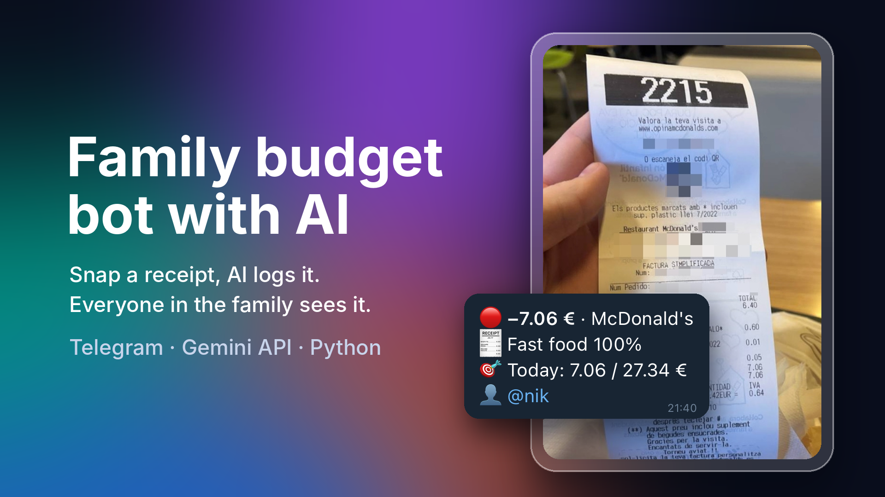
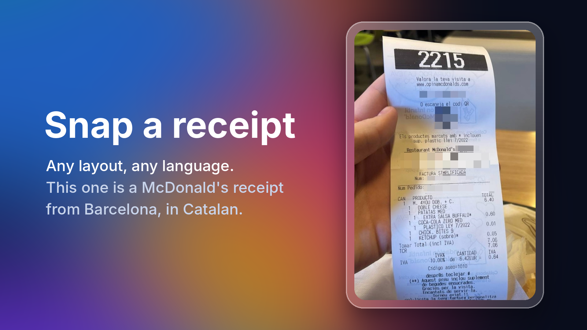
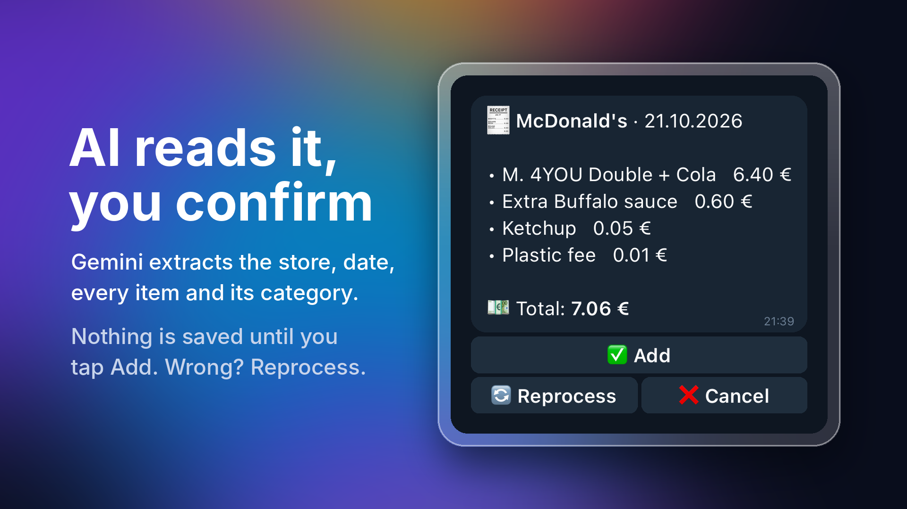
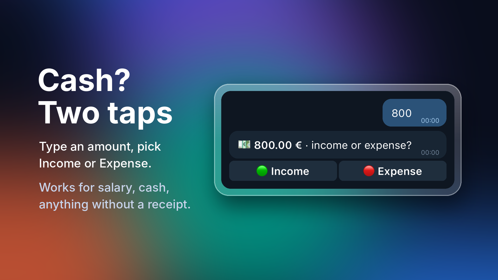
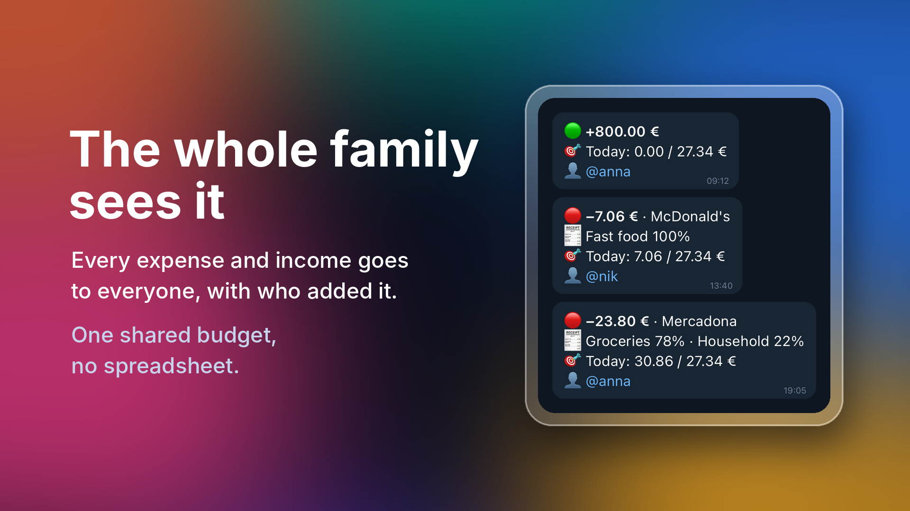
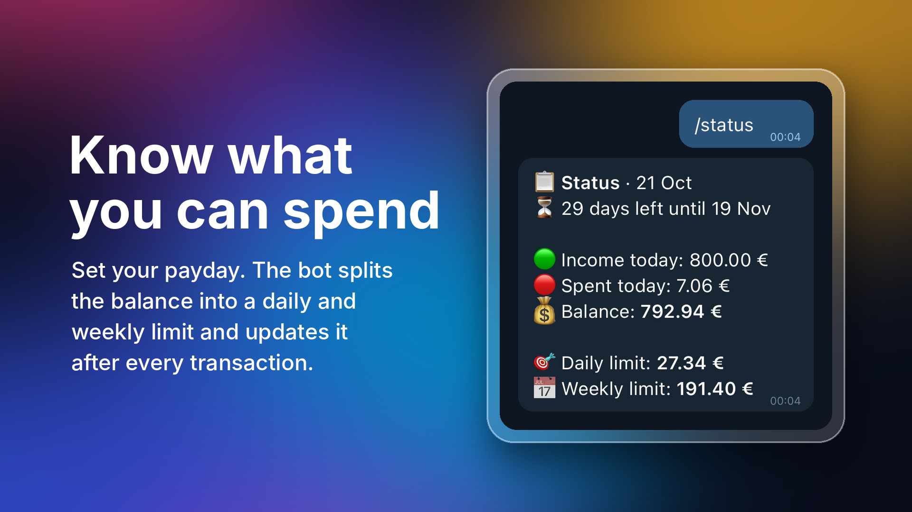
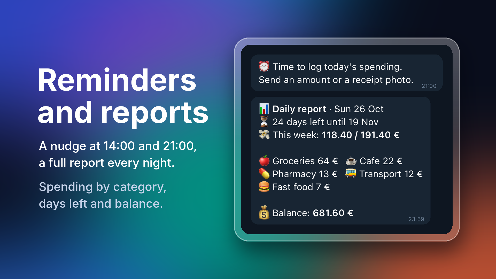
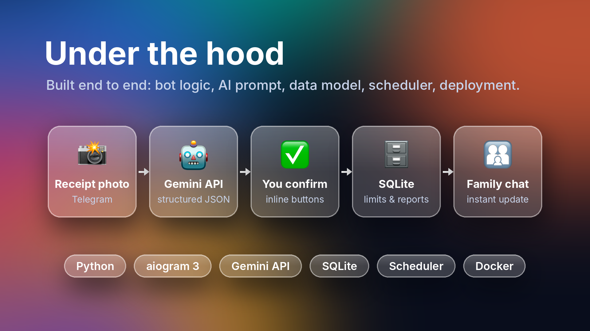
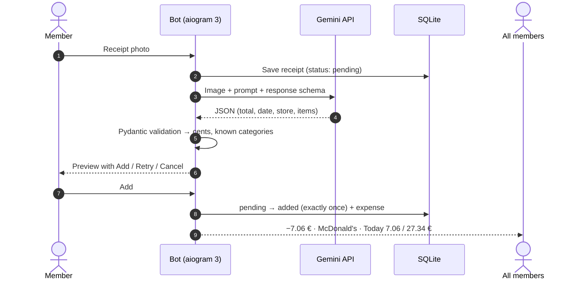
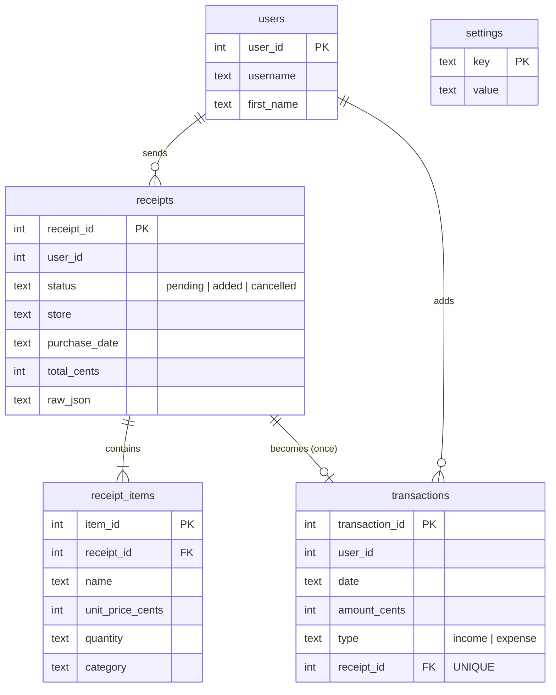

<p align="center">
  
</p>

<h1 align="center">Budget Control Bot</h1>

<p align="center">
  <b>A shared Telegram budget for families and couples.</b><br>
  Snap a receipt, AI logs it, and everyone sees how much is left to spend today.
</p>

<p align="center">
  
  
  
  
  
  
  
</p>

<p align="center">
  <a href="#walkthrough">Walkthrough</a> ·
  <a href="#features">Features</a> ·
  <a href="#engineering">Engineering</a> ·
  <a href="#setup">Setup</a> ·
  <a href="#for-business">For business</a>
</p>

---

## 💡 The problem

Tracking expenses by hand is tedious, so most people quit after a week or a month. For families and couples it's even harder: several people spend from one budget, nobody knows how much is left, and *"can we still afford this?"* turns into a guess.

## ✅ The solution

Send a photo of a receipt to a Telegram bot. **Google Gemini** reads the merchant, total and category, and the bot replies with what's left of your daily budget. Every member of the family sees every entry. Every evening you get a weekly report by category and a countdown to your goal date.

<a id="walkthrough"></a>

## 📸 Walkthrough



**1. Snap a receipt.** Any layout, any language. The example is a Catalan McDonald's receipt from Barcelona.



**2. AI reads it, you confirm.** Gemini returns the store, date, every line item and its category. Nothing is saved until a person taps **Add**.



**3. No receipt? Two taps.** Type an amount and choose *Income* or *Expense*. Salary, cash, transfers.



**4. The whole family sees it.** Every entry is sent to all members with who added it. One shared budget, no spreadsheet.



**5. Know what you can spend.** Set the next payday. The bot splits the balance into a daily and weekly limit and recalculates it after every transaction.



**6. Reminders and reports.** Nudges at 14:00 and 21:00, a full report every night: spending by category, days left and balance.

> The slides use example names and amounts for illustration. Message layouts match what the bot sends.

<a id="features"></a>

## ✨ Features

- **Shared by design.** Every income and expense is broadcast to all members with the author.
- **Receipt recognition.** Store, date, total and line items with categories, confirmed by a human before anything is saved.
- **Quick manual entry.** Type `12,50`, tap *Income* or *Expense*.
- **Adaptive limits.** Balance ÷ days until the target date, as daily and weekly limits.
- **Nightly report** at 23:59 and **reminders** at 14:00 and 21:00 (configurable, time-zone aware).
- **12 categories:** groceries, fast food, cafe, alcohol, smoking, pharmacy, clothing, household, electronics, transport, services, other.
- **English or Russian UI** with one setting.
- **Members only.** Only listed Telegram users can talk to the bot. Admin-only date changes and resets with confirmation.

## ⚙️ How it works





<a id="engineering"></a>

## 🛠️ Engineering highlights

**AI you can rely on**
- Gemini is called through the official **Google Gen AI SDK** with **structured output**: a Pydantic `response_schema`, `response_mime_type="application/json"` and `temperature=0`. No regex-scraping JSON out of free text.
- Every answer is **validated again** on our side: amounts become integer cents, unknown categories fall back to *other*, items without a price are dropped, unreadable fields stay empty instead of being guessed.
- The prompt carries **local business rules**, for example Barcelona metro tickets (*T-Usual*, *T-Jove*) count as transport and tobacco or vape shops as smoking.
- Each request runs **async with a timeout**, so a slow API never blocks other users. A failed recognition still keeps the receipt, so the user can retry or cancel.

**Correct money and data**
- Money is stored as **integer cents**, never floats. Dates are ISO strings in the configured **time zone**, and weeks and "today" are computed in that zone.
- Receipts move through a small state machine: `pending → added | cancelled`. Status changes are compare-and-set, and `transactions.receipt_id` is `UNIQUE`, so a **double tap can't add an expense twice**.
- Inline buttons use **typed `CallbackData`** that carries the id of its own receipt instead of acting on "the latest one".
- **Automatic migration** from the first version of the bot: a backup is written first, and if any row can't be converted nothing changes and the bot stops with a clear error.

**Production basics**
- Typed settings with **pydantic-settings**: an invalid `.env` stops the bot at startup with a list of what to fix.
- **APScheduler** cron jobs in the configured time zone instead of a sleep loop.
- **Access middleware** for members and an admin filter for `/date` and `/restore`.
- **loguru** logging that never writes secrets or receipt contents.
- **Docker** image runs as a non-root user, with volumes for the database and logs.

**Quality**
- 60+ **pytest** tests: budget math (limits, week boundaries, last days before the target date), receipt JSON validation with a mocked Gemini client, message formatting, the legacy migration and **full handler flows through a real aiogram dispatcher with a fake Telegram API**.
- **mypy --strict** and **ruff** (lint and format).

### Data model



## 💬 Commands

| Command | Who | What it does |
|---|---|---|
| `/start` | everyone | Prompt to enter an amount or send a receipt |
| `/status` | everyone | Today's income and spending, balance, daily and weekly limit |
| `/help` | everyone | Short usage guide |
| `/date` | admins | Set the target date (e.g. next payday) |
| `/restore` | admins | Reset all transactions and receipts, after a confirmation |

<a id="setup"></a>

## 🚀 Setup

You need a bot token from [@BotFather](https://t.me/BotFather), a Gemini API key from [Google AI Studio](https://aistudio.google.com/apikey) and the Telegram user ids of the members (e.g. from [@userinfobot](https://t.me/userinfobot)).

```bash
git clone https://github.com/fpoweredd/Telegram-Budget-Control-Bot.git
cd Telegram-Budget-Control-Bot
cp .env.example .env   # then fill in the values
```

**With Docker**

```bash
docker compose up -d --build
docker compose logs -f bot
```

The database lives in the `bot-data` volume (`/data/budget.db`), logs in `bot-logs`.

**Without Docker** (Python 3.12+)

```bash
python3.12 -m venv .venv
source .venv/bin/activate
pip install -r requirements.txt
python -m src
```

An existing `budget.db` from the first version is upgraded automatically on the first start, after a backup (`budget.db.bak-pre-v1-…`).

### Configuration

All settings come from environment variables or `.env`.

| Variable | Required | Default | Description |
|---|---|---|---|
| `TELEGRAM_BOT_TOKEN` | yes | | Bot token from @BotFather |
| `GOOGLE_API_KEY` | yes | | Gemini API key |
| `ADMIN_IDS` | yes | | Comma-separated Telegram user ids of admins (at least one) |
| `USER_IDS` | no | empty | Other members. Only they get reminders |
| `GEMINI_MODEL` | no | `gemini-flash-latest` | Any Gemini model that supports structured output |
| `GEMINI_TIMEOUT_SECONDS` | no | `60` | Timeout for one recognition request |
| `LANGUAGE` | no | `en` | `en` or `ru` |
| `CURRENCY` | no | `€` | Symbol shown after amounts |
| `TIMEZONE` | no | `Europe/Madrid` | IANA time zone for "today", weeks and the schedule |
| `REPORT_TIME` | no | `23:59` | Time of the nightly report |
| `REMINDER_TIMES` | no | `14:00,21:00` | Comma-separated reminder times |
| `DEFAULT_TARGET_DAYS` | no | `30` | Target date on first start and after `/restore` |
| `DB_PATH` | no | `budget.db` | SQLite file location |
| `LOG_LEVEL` | no | `INFO` | `DEBUG`, `INFO`, `WARNING` or `ERROR` |

## 🧪 Development

```bash
pip install -r requirements-dev.txt
ruff format . && ruff check .
mypy src tests
pytest
```

### Project structure

```
src/
├── __main__.py            # entry point: python -m src
├── app.py                 # wiring: bot, dispatcher, services, scheduler
├── config.py              # typed settings (pydantic-settings)
├── logging_setup.py       # loguru sinks
├── domain/                # money (cents), categories, models: no I/O
├── db/                    # aiosqlite connection, schema, migrations, repositories
├── services/
│   ├── budget_math.py     # pure functions: limits, weeks, category splits
│   ├── budget_service.py
│   ├── receipt_parser.py  # Gemini structured output + validation
│   ├── receipt_service.py # receipt lifecycle: pending → added / cancelled
│   └── notifier.py        # broadcast to all members
├── handlers/              # /start, /status, manual entry, receipts, admin
├── texts/                 # en.py, ru.py: every user-facing string
├── formatting.py          # builds every message (HTML)
├── keyboards.py           # inline keyboards with typed callback data
├── middlewares.py         # members-only access, admin filter
└── scheduler.py           # APScheduler cron jobs in TIMEZONE
tests/                     # pytest suite
```

<a id="for-business"></a>

## 💼 For business

The core of this bot is a reusable pipeline: **photo of a document → AI → validated, structured data → human approval → shared update**. The same pipeline solves expensive, boring problems for companies:

| Use case | What changes |
|---|---|
| **Supplier invoices and delivery notes** | Staff photograph invoices on arrival. Supplier, VAT, totals and line items go straight to Google Sheets or accounting software (Holded, QuickBooks, Xero) instead of being typed in by hand. |
| **Employee expense reports** | Employees snap receipts on the go, a manager approves them in Telegram, and finance gets a ready reimbursement export at the end of the month. Per-person and per-category limits. |
| **Restaurants and shops** | Track supplier prices over time and get an alert when the same product suddenly costs more. Daily spend vs. budget for each location. |
| **Field teams and small offices** | Fuel, parking and materials logged from the road with photo proof, split by project or client. |

**What a production version would add:** multiple teams with invite links and roles, a web dashboard or Telegram Mini App, exports and integrations (Google Sheets, accounting APIs, webhooks), voice notes as input ("12 euros, taxi"), multi-currency, PostgreSQL and webhook mode for scale, and an audit log of who approved what.

**Want something like this for your business?** I build Telegram bots with AI that remove manual data entry, take orders and payments, and answer customers. See [my GitHub profile](https://github.com/fpoweredd) for more.
